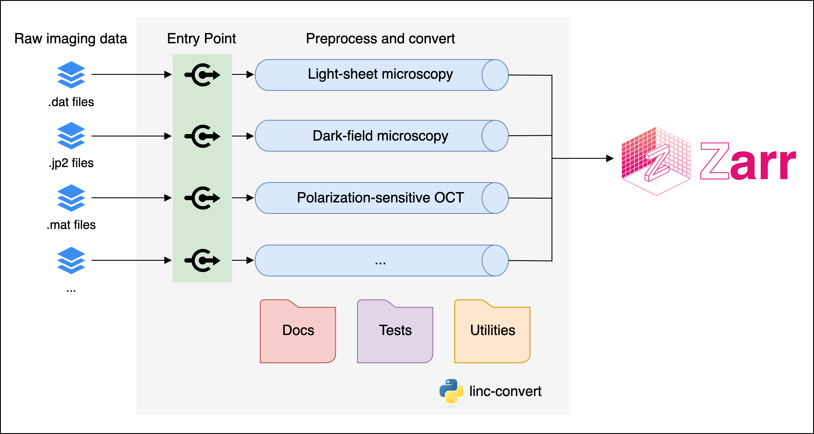

# linc-convert: Data conversion tools for the LINC project

Documentation is available at: https://convert.lincbrain.org

## Kinetix `.prd` light-sheet data

`linc-convert lsm prd` streams `.prd` stacks into a pyramidal NIfTI-Zarr in
bounded memory (a few GB, independent of scan size), with lossless level 0.
For write-once, read-many archives, use
`--chunk 32 --max-shard-size 5TB --compressor-opt.clevel 1`.
See [docs/lsm_prd.md](docs/lsm_prd.md) for the measured trade-offs and how
to keep up with acquisition rates.

